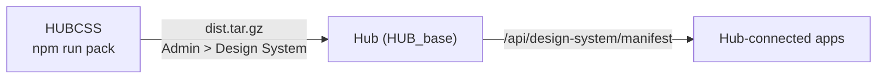

# HUBCSS


HUBCSS is the design-system source used by the Hub and Hub-connected
applications. It builds offline-friendly CSS, icons, and fonts into one
versioned artifact that the Hub serves at runtime.

The package stays intentionally small:

- Tailwind CSS v4 source CSS with CSS-first tokens.
- Prebuilt static CSS for prototypes and non-Tailwind consumers.
- Lucide icons compiled into one SVG sprite.
- Bootstrap Icons font assets for legacy Hub application icons.
- Optional React Icon helper for svg use references.
- No CDN dependency, no CSS-in-JS runtime, no external font request.
- One canonical production distribution path: build HUBCSS, upload the packed
  artifact to the Hub, and let applications sync from the Hub manifest.

## Place In The POULIDOR Park

HUBCSS is one component of the POULIDOR park:



The Hub is the runtime distributor: an administrator uploads the packed artifact under
**Admin > Design System**, and applications keep a local seed fallback, then sync the
canonical bundle from the Hub manifest. Sibling repos:
[HUB_base](https://github.com/poulidor-hub/HUB) (serves the
runtime assets) and
[HUBapp_TEMPLATE_base](https://github.com/poulidor-hub/HUBapp-template)
(consumes the design system in generated apps).

### Updating a deployment

The design system is consumed by deployments through the
[POULIDOR](https://github.com/poulidor-hub/POULIDOR) meta-repository (submodule):
a deployment updates from its root — `git fetch upstream && git merge --ff-only
upstream/main && git submodule update --init --recursive` — this public repository
being read-only for clients.

## Status

HUBCSS is ready for public source distribution on GitHub. The production
distribution model for this stack is Hub-served runtime assets: `npm run pack`
produces a `dist.tar.gz` that an administrator uploads in the Hub under
**Admin > Design System**. Applications keep a local seed fallback, then sync
the canonical runtime bundle from `/api/design-system/manifest`.

Public source repository: <https://github.com/poulidor-hub/HUBCSS>

## Install

For production Hub deployments, build and pack the Hub artifact:

```bash
npm install
npm run pack
```

Upload the resulting `dist.tar.gz` to the Hub. Tarball install, Verdaccio, and
workspace dependencies are kept as development/test workflows, not the
production contract for Hub applications.

## Use In A Tailwind v4 App

Import the source stylesheet from the app entry CSS so Tailwind only emits the
utilities used by the consuming application:

```css
@import "@poutchouli/design-system/source.css";
```

Use this for standalone package experiments. Hub-connected applications should
prefer the runtime sync path documented in `docs/HOW2USE.md`.

## Use The Prebuilt CSS

For prototypes or plain static pages, import the generated CSS directly:

```js
import '@poutchouli/design-system';
```

The prebuilt stylesheet is emitted as `dist/global.css` during `npm run build`.

## Use Icons In React

The build generates one SVG sprite and a small React helper.

```js
import { Icon } from '@poutchouli/design-system/react';

export function SaveButton() {
  return <button className="hub-button"><Icon name="save" />Save</button>;
}
```

By default the helper targets `/design-system/icons/lucide.svg`. If your app
publishes assets elsewhere, pass a custom sprite path.

Add or remove icons in `src/icons/icons.manifest.json`, then rebuild.

## Build

```bash
npm install
npm run build
```

The build produces:

- `dist/global.css`
- `dist/fonts.css`
- `dist/bootstrap-icons/bootstrap-icons.css`
- `dist/bootstrap-icons/fonts/bootstrap-icons.woff`
- `dist/bootstrap-icons/fonts/bootstrap-icons.woff2`
- `dist/icons/lucide.svg`
- `dist/react/Icon.js` `dist/react/Icon.d.ts`
- `dist/react/HighlightText.js` `dist/react/HighlightText.d.ts`
- `dist/react/SearchBadgeBar.js` `dist/react/SearchBadgeBar.d.ts`
- `dist/react/SearchInput.js` `dist/react/SearchInput.d.ts`
- `dist/react/Skeleton.js` `dist/react/Skeleton.d.ts`
- `dist/react/EmptyState.js` `dist/react/EmptyState.d.ts`
- `dist/react/Timeline.js` `dist/react/Timeline.d.ts`
- `dist/react/StatCard.js` `dist/react/StatCard.d.ts`

## Demo

The reference demo lives in `examples/minimal-react` and consumes the package
through the same public imports as a real application.

```bash
npm install
npm run build
cd examples/minimal-react && npm install && cd ../..
npm run demo:build
npm run demo:dev
```

The demo validates tokens, theme variables, buttons, forms, badges, tables,
Lucide sprite usage, and responsive behavior. See `docs/DEMO.md` for the full
manual checklist.

## Quality Gates

Run these checks before tagging or publishing:

```bash
npm run build
npm run check:offline
npm run check:budgets
npm run demo:build
npm pack --dry-run
```

The offline check fails when runtime files contain external asset URLs or common
CDN domains.

## Documentation

- `docs/HOW2USE.md` explains the Hub-served runtime model and app fallback seed.
- `docs/CASCADE.md` explains the CSS cascade/layers contract (app resets, curated
  utility set, safe `hub-*` extension patterns).
- `docs/DEMO.md` covers the reference validation flow.
- `docs/LOCAL_ASSETS.md` explains Hub runtime assets and local fallback seeds.
- `docs/PERFORMANCE.md` documents the current bundle budgets.
- `docs/VERDACCIO.md` documents the development-only private registry workflow.

## Contributing And Support

- `CONTRIBUTING.md` explains contribution expectations.
- `SECURITY.md` explains how to report vulnerabilities.
- `SUPPORT.md` explains where to ask for help.
- `CODE_OF_CONDUCT.md` sets the participation rules.

Issues and pull requests are tracked in the public repository.

## License

This package is MIT licensed. Proprietary applications may consume it without
opening their source code. Keep the license and notice files in technical
distribution material; no visible in-app attribution is required.
